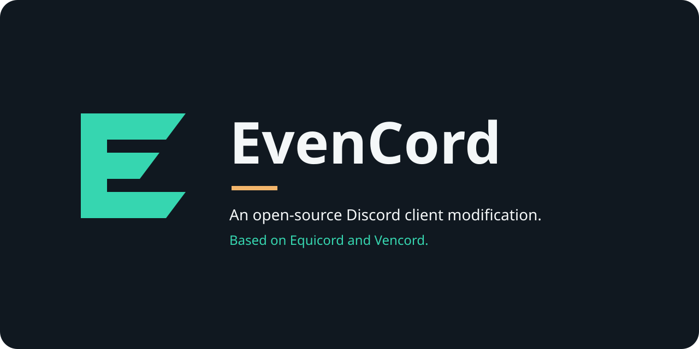

<p align="center"></p>

# EvenCord Installer

The Windows installer for [EvenCord](https://github.com/alrimii/evencord), an independent Discord client modification based on Equicord and Vencord. Derived from Equilotl, with explicit ownership, authenticated payloads and recovery support.

**Public beta preparation:** `0.1.0-beta.1`. Download links are added only after signed artifacts pass release verification. The initial target is Windows 10/11 x64 and Discord Stable 1.0.9266 with the exact reviewed archive. Other channels, architectures and unknown archive hashes are rejected.

## Install

1. Use official Discord Stable. Remove any existing modification using its supported uninstaller first; this installer refuses Equicord, Vencord, OpenAsar and unknown loaders.
2. Fully quit Discord, including its tray process.
3. Download the approved `EvenCordInstaller-x64.exe` once the beta is published.
4. Select **Detect Discord Stable**, then **Install / Update**. Launch Discord after the operation completes.

The optional CLI is `EvenCordInstallerCli-x64.exe`. Use `--help` for operation flags. Neither variant downloads official Equicord binaries as a fallback.

## Repair, recovery and removal

- **Repair** retrieves signed release metadata and re-verifies the payload before applying it.
- **Recover** checks the transaction journal after an interrupted operation.
- **Uninstall** removes only recognized EvenCord loader files and restores the verified original Discord archive.
- EvenCord settings in `%APPDATA%\EvenCord` are preserved by default.

Do not delete `_app.asar`, ownership records or recovery data manually. File locks and permission errors are failures, not successful operations. Private EvenCord previews use a separate trust identity and are not silently converted by the public beta installer.

## Verification and updates

Ed25519 signatures bind the product, repository, channel, version, commits, compatibility, artifact size and SHA-256. The pinned public verifier is embedded in both components. Downloads use bounded HTTPS and staging; the original loader and last known-good state are preserved.

**Windows Authenticode signing is not present.** SmartScreen and unknown-publisher warnings are possible. Ed25519 is independent of Windows publisher trust. Do not disable security globally to run a download.

Automatic updates, self-update and Discord repatching remain disabled. Use a verified new installer for manual upgrades. New Discord bootstrap archives require explicit compatibility review. See [release security](docs/RELEASE-SECURITY.md) and [approved compatibility](branding/discord-compatibility.json).

## Build from source

Use the Go version in `go.mod`, Node.js 22 for verification tooling, `go-winres`, and a Windows x64 C/C++ compiler compatible with giu/GLFW for the GUI. The project retains the upstream `equilotl` Go module for compatibility.

```powershell
go run ./cmd/brand-resources -cli
go-winres make --in build/winres.json --arch amd64
go build -tags cli -trimpath -o build/EvenCordInstallerCli-x64.exe .
go run ./cmd/brand-resources
go-winres make --in build/winres.json --arch amd64
go build -tags 'static gui' -trimpath -ldflags '-H=windowsgui' -o build/EvenCordInstaller-x64.exe .
```

Building does not install the client. Core release payloads must be built and signed separately. `cmd/beta-check` verifies downloads or a disposable fixture without discovering or modifying installed Discord. Read its flags before use.

## Feedback and attribution

[Report installer issues](https://github.com/alrimii/evencord-installer/issues) with the version, target Discord version and error. Remove personal paths, account data and secrets from logs. Report plugin problems in the [core repository](https://github.com/alrimii/evencord/issues).

Based on [Equilotl](https://github.com/Equicord/Equilotl), [Equicord](https://github.com/Equicord/Equicord) and [Vencord](https://github.com/Vendicated/Vencord). Original history, authorship and GPL notices remain intact; see [LICENSE](LICENSE). Release tags provide corresponding source. This is not an official Discord, Equicord or Vencord installer.

[Phase 2](PHASE2.md) and [Phase 3](PHASE3.md) are historical engineering records, not current release instructions. EvenCord remains an experimental beta, not production-stable software.
